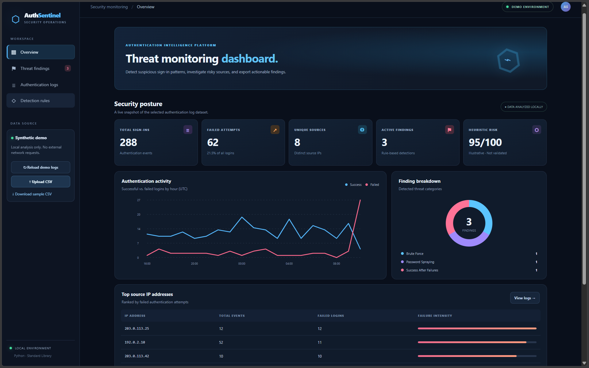

# AuthSentinel 🛡️

A **local authentication threat-monitoring dashboard** for a cybersecurity portfolio. It flags potential brute force attempts, password spraying and successful logins that follow repeated failures. All example login data is synthetic.

  

## Quick start

```bash
python app.py
```

Open **http://127.0.0.1:8502** if the browser doesn't open automatically. Requires only Python 3.10 or newer; no `pip install`, third-party packages, or network access.

> Port 8502 already in use? Stop the other running app with `Ctrl + C`. Alternatively in PowerShell, run `$env:AUTHSENTINEL_PORT=8502; python app.py`.

## Features

- SOC-style responsive dark dashboard
- Synthetic login event dataset with known attack-like patterns
- Rule-based detection of **Brute Force**, **Password Spraying**, and **Success After Failures**
- Severity-sorted findings with MITRE ATT&CK mapping and recommended analyst response
- Authentication trends, finding distribution, and top source IPs
- File upload for user-provided CSV, with row-level validation
- Filter alerts by severity, search event logs, export findings and events as CSV
- Unit tests for detection logic
- Privacy-respecting local processing: uploaded CSV is analyzed in memory, not written to disk

## CSV format

```csv
timestamp,ip_address,username,status
2026-10-01T10:00:00Z,203.0.113.25,alex,failed
2026-10-01T10:01:00Z,203.0.113.25,alex,success
```

Status must be `failed` or `success`. Timestamps should be ISO-8601. Missing timezone is interpreted as UTC. Invalid rows are skipped and reported. Uploads are limited to 5 MB, and at most 50,000 valid rows are analyzed.

## Detection rules

| Rule | Threshold | Severity | MITRE |
|------|-----------|----------|-------|
| Brute Force | >= 6 failures on 1 account from 1 IP within 10 min | Medium, High at >= 10 | [T1110](https://attack.mitre.org/techniques/T1110/) |
| Password Spraying | >= 8 failures against >= 5 accounts from 1 IP within 10 min | High | [T1110.003](https://attack.mitre.org/techniques/T1110/003/) |
| Success After Failures | Successful login after >= 4 failed attempts for same IP/account within 15 min | Critical | [T1110](https://attack.mitre.org/techniques/T1110/) |

All rules are **heuristics** and can produce false positives. Severity and risk scoring are illustrative rather than validated. A suspicious successful login does not prove compromise.

## Technology

- **Python standard library**: `http.server`, `csv`, `datetime`, `collections`, `ipaddress`, `unittest`
- **Frontend**: HTML, CSS, JavaScript and SVG (no CDN or framework)
- **Detection engine**: `detector.py` (pure Python)
- **Synthetic data**: `generate_logs.py`

This version deliberately avoids **NumPy**, **pandas**, and **Streamlit** because some Windows Application Control policies block native extension DLLs from those packages. **Do not disable security controls** to run a portfolio project.

## Tests

```bash
python -m unittest discover -s tests -v
```

## Project layout

```
AuthSentinel_Fixed/
├── app.py                  # Local HTTP server & dashboard API
├── detector.py             # Attack-pattern detection logic
├── generate_logs.py        # Safe sample CSV generator
├── data/sample_auth_logs.csv
├── static/
│   ├── index.html
│   ├── dashboard.css
│   └── dashboard.js
├── tests/test_detector.py
├── .github/workflows/test.yml
├── LINKEDIN_AND_CV.md
└── START_HERE_AR.txt
```

## Limitations / safety

This is a learning/demo tool, not a production SIEM, intrusion detection or protection product. It analyzes uploaded CSV log content **locally**; it does not scan networks, interact with real accounts or block IP addresses. It only listens on `127.0.0.1` to avoid exposure to other devices. Do not upload secrets or sensitive business logs in a publicly deployed copy.

MIT License.
## Dashboard Preview


